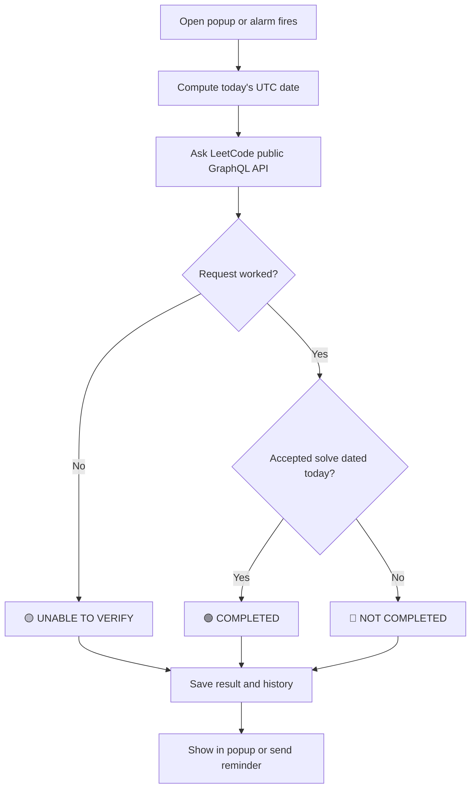

<div align="center">

# 🛡️ LeetCode Streak Guardian

**Never lose your LeetCode streak to the 5:30 AM IST reset again.**

A lightweight Chrome extension that tells you if *today's LeetCode day* is done, and reminds you before it resets.


</div>

---

## 😵 The Problem

You study late. It's 4 AM. You solved a problem a few hours ago and think:

> *"I already did my LeetCode today. I'm safe."*

**You might not be.**

- Your phone follows **IST dates** (a new day starts at 12:00 AM).
- LeetCode follows **UTC** (a new day starts at **5:30 AM IST**).

So from **12:00 AM to 5:29 AM IST**, your phone says it's the new day, but LeetCode is still on the *old* one. Anything you solve in that window counts for the **previous** day. Then at 5:30 AM a **fresh, empty day** begins while you sleep.

### How a streak quietly breaks

| IST time | What you think | What LeetCode counts |
|---|---|---|
| Mon 11:00 PM | You solve a problem | ✅ Counts for **Monday** |
| Tue 1:00 AM | "It's Tuesday and I solved something tonight, so Tuesday is done" | ⚠️ Still **Monday's** day |
| Tue 5:30 AM | You're studying or asleep | 🆕 **Tuesday starts, completely empty** |
| Tue afternoon | "I did LeetCode last night, I'm good" | ❌ Tuesday still has **zero** activity |
| Wed 5:30 AM | You wake up | 💔 **Tuesday ended empty. Streak gone.** |

It isn't laziness. It's a **time zone trap**. That is what this extension fixes.

---

## ✨ What It Does

| Feature | Details |
|---|---|
| 🟢🔴🟡 **Clear status** | `COMPLETED`, `NOT COMPLETED` or `UNABLE TO VERIFY` for the *current LeetCode day* |
| 🕐 **Two clocks** | LeetCode date (UTC) and India date/time side by side |
| ⏳ **Live countdown** | Time left until the 5:30 AM IST reset |
| 🔔 **Smart reminder** | Notifies at **4:30 AM IST** (configurable), only if your day looks empty |
| 🗂️ **History** | Status of the last few days |
| 🔒 **Private** | Public username only. No password, cookies or tokens |
| 🪶 **Lightweight** | Plain HTML, CSS and JavaScript. Zero dependencies |

### Preview of the popup

```
┌─────────────────────────────────────────┐
│ 🛡️ LeetCode Streak Guardian        ⚙️  │
│ Your day follows UTC, resets 5:30 AM IST│
├─────────────────────────────────────────┤
│  ● NOT COMPLETED                        │
│  No accepted submission found for today │
│  (UTC). Solve one before the reset.     │
│  [Check succeeded]  Last checked: 4:12 AM│
├────────────────────┬────────────────────┤
│ LeetCode day (UTC) │ India now          │
│ 2026-10-20         │ 04:12:09 AM        │
├────────────────────┴────────────────────┤
│ Time until reset (5:30 AM IST)          │
│ 01:17:51   ▓▓▓▓▓▓▓▓▓▓▓▓▓▓▓▓▓░░          │
├─────────────────────────────────────────┤
│ [ Check now ]      [ Open LeetCode ]    │
└─────────────────────────────────────────┘
```

---

## 🚦 What Each Status Means

| Status | Color | Meaning |
|---|---|---|
| **COMPLETED** | 🟢 Green | An **accepted** submission dated today (UTC) was found |
| **NOT COMPLETED** | 🔴 Red | Accepted list loaded and nothing is dated today |
| **ACTIVITY DETECTED** | 🟢 Green | Only the calendar worked: submissions exist today, but **acceptance is not verified** |
| **NO ACTIVITY DETECTED** | 🔴 Red | Only the calendar worked and it shows **zero** submissions today |
| **UNABLE TO VERIFY** | 🟡 Yellow | Network error, rate limit, wrong username or changed API |

> 🛑 **Golden rule:** a failed request is **never** shown as "you missed it". It always becomes `UNABLE TO VERIFY`. This is covered by unit tests.

---

## 🧠 How It Works



1. **Finds the real LeetCode day.** It uses the UTC date, never your computer's local date. The reset is the next 00:00 UTC, which is 5:30 AM IST.
2. **Reads your public profile.** Two public queries are used:
   - `submissionCalendar` gives daily submission counts, but includes failed attempts.
   - `recentAcSubmissionList` gives your recent *accepted* solves with timestamps.
3. **Decides the status** using the table above.
4. **Caches carefully.** Results are tied to their UTC date and discarded when the day changes. Checks within 15 seconds reuse the cache to avoid rate limits.
5. **Reminds you.** A Chrome alarm fires at your reminder time. The extension checks LeetCode *at that moment* and only notifies if needed. One reminder per day, and stale alarms are ignored.

<details>
<summary><b>🔔 More detail on reminders</b></summary>

- Default time is **4:30 AM IST**, which equals **23:00 UTC**, one hour before reset. You can change it in Settings.
- If the check **fails**, the notification says *"couldn't verify"*. It never claims your day is empty.
- It reschedules itself on install, browser startup, extension reload and settings changes.
- A 15-minute backup alarm repairs the schedule and sends a late reminder if one was missed while the day is still current.
- **Limits:** Chrome alarms can fire late, and nothing runs while Chrome is fully closed. Windows *Focus assist* can hide notifications. That's why the popup also checks live every time you open it.

</details>

---

## 📁 Project Structure

```
leetcode-streak-guardian/
├── manifest.json        # Permissions, popup, service worker
├── popup.html           # Popup layout
├── popup.css            # Dark navy theme
├── popup.js             # Clock, countdown, buttons, settings
├── background.js        # Reminder scheduling and notifications
├── lib/
│   ├── time.js          # UTC/IST math and countdown
│   ├── leetcode.js      # API requests and error handling
│   ├── status.js        # Turns API data into a status
│   ├── storage.js       # Settings, cache, history
│   └── checker.js       # One full status check (shared)
├── icons/               # 16, 48, 128 px icons
└── tests/               # Optional unit tests
```

**Permissions used:** `alarms`, `notifications`, `storage`, and access to `https://leetcode.com/*` only.

---

## 🚀 Installation (Windows)

No build tools needed.

1. **Download** this repo (green **Code** button, then **Download ZIP**) and extract it.
2. *(Optional)* Open the folder in [VS Code](https://code.visualstudio.com/) to read the code.
3. Open Chrome and go to `chrome://extensions`.
4. Turn on **Developer mode** (top right).
5. Click **Load unpacked** and select the folder that contains `manifest.json`.
6. Click the 🧩 puzzle icon and **pin** *LeetCode Streak Guardian*.
7. Open it, enter your **public LeetCode username** and click **Save**.

> 💡 After editing any file, click the **reload** icon on the extension card in `chrome://extensions`.

---

## 🧪 Testing

**Manual checks**

1. Solve a problem, open the popup and click **Check now**. Expect 🟢 `COMPLETED` (wait a minute if it lags).
2. Enter a fake username. Expect 🟡 `UNABLE TO VERIFY`.
3. Turn off Wi-Fi and click **Check now**. Expect 🟡, never 🔴.
4. Click **Test notification**, then click the notification. LeetCode should open.
5. Set the reminder 2-3 minutes ahead (IST) and save. With no accepted solve today, you should get the alert.

**Automated tests** (needs [Node.js](https://nodejs.org/)):

```bash
npm test
```

28 tests cover the 5:30 AM IST boundary, reminder math, status rules, error handling and cache invalidation.

---

## ⚠️ Honest Limitations

- LeetCode's endpoints are **public but unofficial** and may change. If so, you'll see `UNABLE TO VERIFY` with an explanation, not a wrong answer.
- The accepted list can **lag a minute or two** after you submit. Wait, then click **Check now**.
- The public calendar counts all submissions, not only accepted ones. That is why accepted status comes from the separate accepted list.
- Live LeetCode behavior was not tested in the build environment. Please use the manual checks above and report any issue.

---

## 🔒 Privacy

- Only **public** data is read. No password, cookie or token is ever requested or stored.
- Requests are sent without credentials.
- Stored locally in your browser: username, reminder settings, latest result and a 14-day status log.
- The only site contacted is `leetcode.com`.

---

## 🤝 Contributing

Ideas welcome: weekly stats, sound alerts, Firefox support, or a streak counter. Open an issue or a pull request.

## 📄 License

MIT. Free to use, modify and share.

---

<div align="center">

**Built for night-owl coders who refuse to lose their streak. 🦉**

</div>
